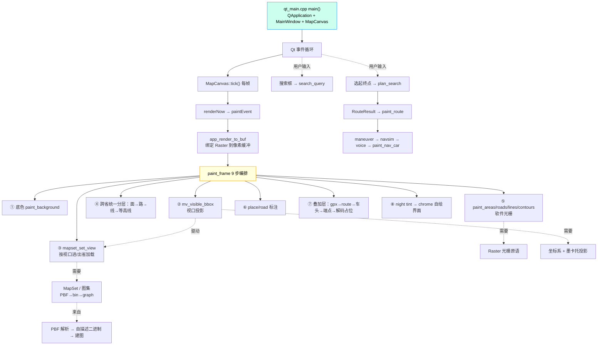

# 第 1 课 · 课程总览与程序运行流程

> 模块：全局（本目录 14 课 + 综合项目）
> 前置：无。本课是整门课的"地图"，先建立总览，再按**程序运行流程**逐课深入。

## ① 教学目的

- 建立对本项目的整体认知：它是什么、怎么跑起来、代码是怎么组织的。
- 看懂**程序运行流程图**——一条从"程序入口"到"每一帧像素"再到"用户交互"的主线。
- 明确本课程的排序原则：**按程序运行流程排课**，而非按模块依赖表排课。
- 记住四条贯穿全程的教学法原则，后续每一课都会反复用到。

## ② 功能构成

本目录是 [`../teaching-plan.md`](../teaching-plan.md) 的**逐课展开版**：每一课单独成文件，统一按
**① 教学目的 → ② 功能构成 → ③ 怎么实现 → ④ 与其他功能的联系** 四段式详述，并附课堂演示 / 练习 / 验收。
所有代码事实（函数签名、结构体字段、代码片段）均来自当前 `src/` 真实源码。

### 教学法四条总原则（先讲给学生）

1. **能实测就不要估算**——性能瓶颈、算法正确性一律靠 `scripts/regress.sh`、像素判据、确定性量说话。
2. **核心与窗口解耦**——C 渲染核心一行不动，Qt 只把像素缓冲包成 `QImage`。
3. **依赖是纯 DAG**——`utils ← pbf ← map ← route ← render ← ui ← ui_qt`，反向依赖会立刻 `undefined-reference`。
4. **核心零 SDL**——`navimap_core` 连 SDL 的 include 都不给；SDL 仅残留在两个去 SDL 化对照体里做"逐像素等价"验证。

## ③ 怎么实现：程序运行流程图

本项目的唯一 GUI 进程入口是 `qt_main.cpp` 的 `main()`。它启动 Qt 事件循环，每帧由
`MapCanvas::tick()` 驱动一次 `renderNow() → paintEvent() → app_render_to_buf() → paint_frame()`。
`paint_frame` 内部按固定 9 步把"图集 + 视口"变成"像素缓冲"，并消费搜索 / 路由 / 导航的结果。
下列流程图即本课程的排课依据（从上到下 = 运行时先后）。



ASCII 版（同一张图，便于无 mermaid 渲染时阅读）：

```
qt_main main()                       ┐ 程序入口（第 13 课）
  └─ QApplication + MainWindow + MapCanvas
       └─ Qt 事件循环
            └─ MapCanvas::tick() 每帧
                 └─ renderNow() → paintEvent()
                      └─ app_render_to_buf()         ┐ 唯一渲染入口
                           └─ paint_frame() 9 步      ┘ （第 9 课）
                                ② mv_visible_bbox   → 视口投影（第 7 课）
                                ③ mapset_set_view   → 需要 图集（第 5 课）
                                   └─ 数据来自：PBF→二进制→建图（第 4/5/6 课）
                                ⑤ paint_areas/...    → 需要 Raster（第 8 课）
                                   └─ 依赖：坐标系 + 墨卡托（第 2 课）
                                ⑦ 叠加层：route/gpx/车头
                                ⑧ chrome 自绘界面（含搜索框）
            └─ 用户输入：搜索（第 10 课）/ 选起终点路由（第 11 课）
                            └─ RouteResult → maneuver → navsim → voice（第 12 课）
   全程底座：坐标系（第 2 课）、平台抽象层（第 3 课：线程 / mmap）
   全程守护：架构纪律与验收门禁（第 14 课）
```

### 为什么按这个顺序排课（而非按依赖表）

依赖表 `utils←pbf←map←route←render←ui←ui_qt` 告诉我们"谁不许依赖谁"；而**运行流程**告诉我们
"程序真正跑起来时，先做什么、后做什么"。本课程以运行流程为主轴：

1. **底座先讲**（第 2–3 课）：坐标系、平台抽象层。它们是读任何运行时代码都绕不开的前提。
2. **数据生产流**（第 4–6 课）：PBF 解析 → 自描述二进制 / 图集 → 建图。这正是 `mapset_set_view`
   在视野变化时加载的内容，也是路由的输入。
3. **每帧渲染流**（第 7–9 课）：视口投影（决定可见范围）→ 软件光栅（画像素）→ 渲染管线编排
   （把前两者与数据编织成一帧）。这条线直接对应 `paint_frame` 的内部步骤顺序。
4. **用户交互流**（第 10–12 课）：搜索、路由、导航与语音——按 UI 上触发的先后出现。
5. **外壳与守护**（第 13–14 课）：Qt 前端（程序入口 `main`/事件循环）放在最后，是因为它只是外壳——
   它启动的事件循环每帧调用的 `paint_frame`（第 9 课）所依赖的数据 / 投影 / 光栅都已在前面的课讲完；
   架构门禁（第 14 课）则守护前面所有课。

> 注：严格按 `main()` 的"第一个被调用的函数"来说，Qt 入口应排最前。但那样会导致"还没讲
> 投影 / 光栅 / 数据，就看不懂 paint_frame 在干什么"。因此把入口外壳后置，先夯实它调用的每一个
> 零件，最后再回到入口把它们串起来——这同样忠实于运行流程，只是采用了"自顶向下、按需下钻"的讲法。

## ④ 与其他功能的联系

- 本课是**索引**：后续每一课的"④ 与其他功能的联系"都标了上游（它依赖谁）与下游（谁用它），
  对照本课流程图阅读即可串起"坐标 → 数据 → 渲染 → 路由 → 前端 → 门禁"的完整链路。
- 环境搭建、构建命令、CLI 工具清单见 [`../teaching-plan.md`](../teaching-plan.md) 的「一、环境搭建」。

## 课程表（按运行流程排序）

| 文件 | 课次 | 主题 | 核心模块 |
|---|---|---|---|
| [lesson-01-overview.md](lesson-01-overview.md) | 1 | 课程总览与程序运行流程 | 全局 |
| [lesson-02-coords.md](lesson-02-coords.md) | 2 | 坐标系与大地基准 | `utils/geo`, `utils/datum` |
| [lesson-03-platform.md](lesson-03-platform.md) | 3 | 平台抽象层 | `utils/{plat,mem,strpool}` |
| [lesson-04-pbf.md](lesson-04-pbf.md) | 4 | PBF 流式解析 | `pbf/*` |
| [lesson-05-binmap.md](lesson-05-binmap.md) | 5 | 自描述二进制与图集 | `map/{binfmt,mapset,namepool}` |
| [lesson-06-graph.md](lesson-06-graph.md) | 6 | 建图：PBF→路网 | `map/{graph_build,road_tags}` |
| [lesson-07-viewport.md](lesson-07-viewport.md) | 7 | 视口、投影与瓦片键 | `map/{map_view,tileidx}` |
| [lesson-08-raster.md](lesson-08-raster.md) | 8 | 软件光栅与性能旋钮 | `render/{raster,paint,navdraw}` |
| [lesson-09-pipeline.md](lesson-09-pipeline.md) | 9 | 渲染管线编排 | `ui/{window,chrome,offscreen_shot,audit}` |
| [lesson-10-search.md](lesson-10-search.md) | 10 | 地名搜索 | `search/*` |
| [lesson-11-routing.md](lesson-11-routing.md) | 11 | 跨省路由算法 | `route/*` |
| [lesson-12-navvoice.md](lesson-12-navvoice.md) | 12 | 导航层与语音 | `route/{maneuver,navsim,voice}`, `ui/voice_wire` |
| [lesson-13-qt.md](lesson-13-qt.md) | 13 | Qt 前端与边界 | `ui_qt/*` |
| [lesson-14-gates.md](lesson-14-gates.md) | 14 | 架构纪律与验收门禁 | `scripts/*`, `tools/*` |
| [capstone.md](capstone.md) | ★ | 综合项目 | 全程 |

## 阅读建议

- 顺序即运行流程：第 1 课总览 → 第 2–3 课底座 → 第 4–6 课数据 → 第 7–9 课渲染 → 第 10–12 课交互
  → 第 13 课外壳 → 第 14 课门禁。
- 每课"④ 与其他功能的联系"一节都标了上游与下游，建议对照本课的流程图一起读。
- 先读本课流程图，建立"主干"；再逐课下钻"枝叶"。
